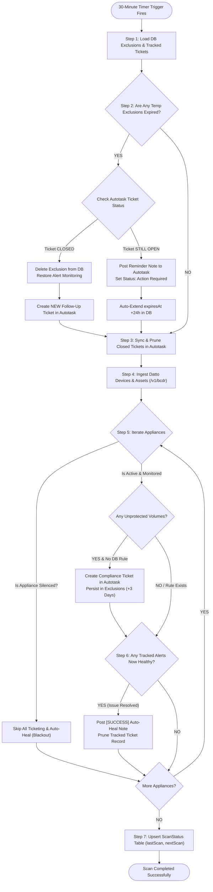
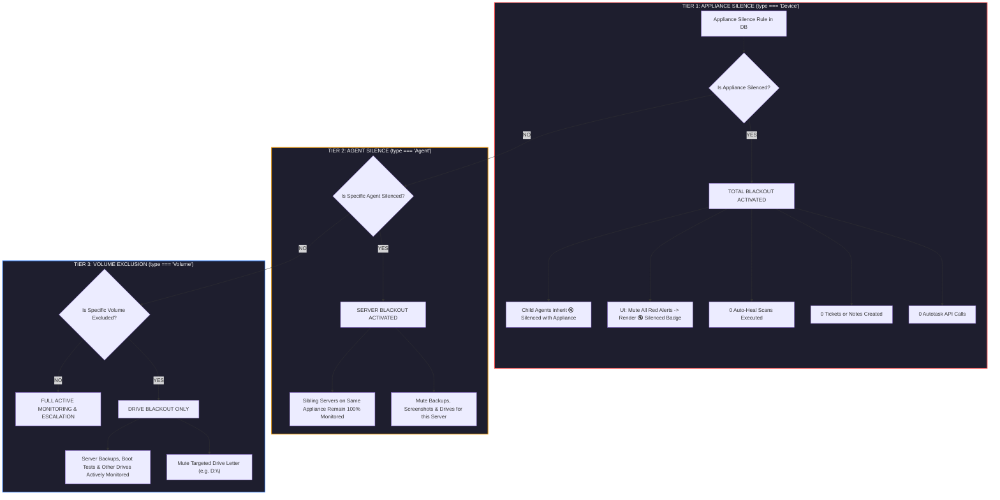
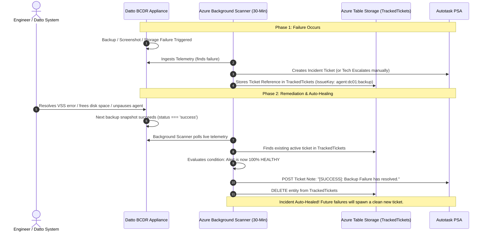
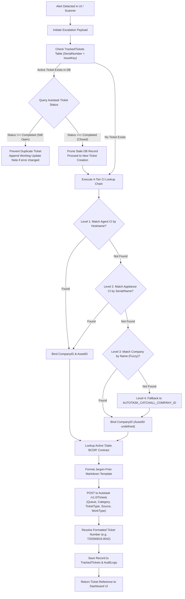

# BackupWatch: Comprehensive Operational Architecture, Workflows, Rules & Scanner Lifecycle Specification

> **Product Name:** Fifosys BackupWatch  
> **Current Version:** v1.23.2  
> **Platform Architecture:** SharePoint Online (Modular SPFx Client) + Azure Serverless (Node.js / TypeScript Functions) + Azure Table Storage + Datto BCDR REST API + Datto Autotask PSA REST API  
> **Document Purpose:** Complete operational reference detailing real-time workflows, business rules, 3-tier silence hierarchy, automatic background scan behaviors, Auto-Heal engines, compliance ticketing, and modular SPFx component architecture.

---

## Table of Contents
1. [System Architecture & Operational Topology](#1-system-architecture--operational-topology)
2. [Core Operational Workflows](#2-core-operational-workflows)
   - [2.1 Real-Time Dashboard Ingestion & Caching Workflow](#21-real-time-dashboard-ingestion--caching-workflow)
   - [2.2 3-Tier Silence & Exclusion System](#22-3-tier-silence--exclusion-system)
   - [2.3 Proactive Volume Pre-Exclusion Workflow (v1.16.0)](#23-proactive-volume-pre-exclusion-workflow-v1160)
   - [2.4 Interactive Issue Escalation Workflow](#24-interactive-issue-escalation-workflow)
   - [2.5 Audit Trail & Governance Logging](#25-audit-trail--governance-logging)
3. [System Rules & Behavioral Guardrails](#3-system-rules--behavioral-guardrails)
   - [Rule 1: Production Safety & Read-Only Ingestion](#rule-1-production-safety--read-only-ingestion)
   - [Rule 2: 3-Tier Silence Cascading & Total Blackout Hierarchy](#rule-2-3-tier-silence-cascading--total-blackout-hierarchy)
   - [Rule 3: Temporary vs. Permanent Exclusion Policies](#rule-3-temporary-vs-permanent-exclusion-policies)
   - [Rule 4: Ticket Deduplication & Single-Ticket Integrity](#rule-4-ticket-deduplication--single-ticket-integrity)
   - [Rule 5: Active vs. Cancelled Subscription Segregation](#rule-5-active-vs-cancelled-subscription-segregation)
   - [Rule 6: Diagnostic Thresholds & Alert Triggers](#rule-6-diagnostic-thresholds--alert-triggers)
4. [Automatic Background Scanner (30-Minute Cycle)](#4-automatic-background-scanner-30-minute-cycle)
   - [4.1 Execution Trigger & Cache Bypass](#41-execution-trigger--cache-bypass)
   - [4.2 Step-by-Step Scanner Pipeline Execution](#42-step-by-step-scanner-pipeline-execution)
   - [4.3 Expiry Sweep Engine (Temporary Exclusions)](#43-expiry-sweep-engine-temporary-exclusions)
   - [4.4 Auto-Ticketing Engine for Native Unprotected Volumes](#44-auto-ticketing-engine-for-native-unprotected-volumes)
   - [4.5 Auto-Heal Engine (Self-Healing Resolved Incidents)](#45-auto-heal-engine-self-healing-resolved-incidents)
   - [4.6 Scan Status & Heartbeat Tracking](#46-scan-status--heartbeat-tracking)
5. [Visual Lifecycle Charts & State Machines](#5-visual-lifecycle-charts--state-machines)
   - [Chart 1: End-to-End System Ingestion & Background Scan Pipeline](#chart-1-end-to-end-system-ingestion--background-scan-pipeline)
   - [Chart 2: 3-Tier Silence & Cascading Blackout Hierarchy](#chart-2-3-tier-silence--cascading-blackout-hierarchy)
   - [Chart 3: Volume Exclusion Lifecycle & Expiry Sweep Decision Tree](#chart-3-volume-exclusion-lifecycle--expiry-sweep-decision-tree)
   - [Chart 4: Auto-Heal & Alert Remediation Lifecycle](#chart-4-auto-heal--alert-remediation-lifecycle)
   - [Chart 5: Manual & Automated Ticket Escalation Pipeline](#chart-5-manual--automated-ticket-escalation-pipeline)
6. [Data Models & Azure Table Storage Schema](#6-data-models--azure-table-storage-schema)
7. [Current Operational Status & Reliability Features](#7-current-operational-status--reliability-features)

---

## 1. System Architecture & Operational Topology

BackupWatch operates as a hybrid serverless cloud monitoring platform connecting **Microsoft 365 / SharePoint Online**, **Azure Serverless Functions**, **Azure Table Storage**, **Datto BCDR API**, and **Datto Autotask PSA**.

```
+-----------------------------------------------------------------------------------+
|                            SHAREPOINT ONLINE (SPFx v1.19.0)                       |
|  - Modern Light/Dark Glassmorphic UI                                              |
|  - Real-time filtering, interactive metric cards, full-screen portal mode         |
|  - Entra ID SSO User Impersonation (Easy Auth)                                   |
+------------------------------------------+----------------------------------------+
                                           | HTTPS / Azure AD Bearer Token
                                           v
+-----------------------------------------------------------------------------------+
|                        AZURE FUNCTION APP (Flex Consumption)                      |
|                                                                                   |
|  [HTTP API: /api/backupWatchTrigger]   <--- Interactive Dashboard Requests        |
|  [HTTP API: /api/exclusions]           <--- Mute/Unmute & Policy Management       |
|  [HTTP API: /api/escalateTrigger]      <--- Manual Autotask Escalations           |
|  [HTTP API: /api/auditLogs]            <--- Audit Trail Retrieval                 |
|  [Timer Trigger: 0 */30 * * * *]      <--- Autonomous 30-Minute Background Scanner|
|                                                                                   |
|  In-Memory Processing Engine:                                                     |
|  - Ephemeral 5-Min Datto BCDR Cache                                               |
|  - 3-Tier Silence Evaluator (volumeUtils.ts)                                      |
|  - 4-Tier Autotask CI Lookup Chain (autotask.ts)                                  |
|  - Expiry Sweep Engine                                                            |
|  - Auto-Heal Engine                                                               |
+------------------+-----------------------------+-------------------+--------------+
                   |                             |                   |
                   v                             v                   v
+-----------------------------+   +-----------------------+   +---------------------+
|     AZURE TABLE STORAGE     |   |    DATTO BCDR REST    |   | DATTO AUTOTASK PSA  |
| - Exclusions (Rules)        |   | - /v1/bcdr/device     |   | - /v1.0/Tickets     |
| - TrackedTickets (Incidents)|   | - /v1/bcdr/device/    |   | - /v1.0/TicketNotes |
| - ScanStatus (Heartbeats)   |   |   {serial}/asset      |   | - /v1.0/Companies   |
| - AuditLogs (Governance)    |   | (Basic Auth, Page 250)|   | - /v1.0/Contracts   |
+-----------------------------+   +-----------------------+   +---------------------+
```

### Live Operational Endpoints & Environment Details:
* **Function App**: `backupwatch-api` (Flex Consumption Linux, Region: UK South)
* **Primary Ingestion URL**: `https://backupwatch-api-e7bsfnanaqdhd7f7.uksouth-01.azurewebsites.net/api/backupWatchTrigger`
* **Exclusions API URL**: `https://backupwatch-api-e7bsfnanaqdhd7f7.uksouth-01.azurewebsites.net/api/exclusions`
* **Escalations API URL**: `https://backupwatch-api-e7bsfnanaqdhd7f7.uksouth-01.azurewebsites.net/api/escalateTrigger`
* **Portal UI Site**: `https://fifosys365.sharepoint.com/sites/BackupWatchPortal`
* **Authentication**: Microsoft Entra ID (Single-Tenant `fifosys365`, App ID URI: `api://04de3dc9-a4e8-4bba-9957-925668bbe027`, Scope: `user_impersonation`)

---

## 2. Core Operational Workflows

### 2.1 Real-Time Dashboard Ingestion & Caching Workflow
1. **User Access & SSO**: The engineer navigates to the SharePoint portal. SPFx requests an Entra ID access token for `BackupWatch-Backend-API` and issues an HTTP GET to `/api/backupWatchTrigger`.
2. **5-Minute Cache Layer**:
   * **Cache HIT (Age < 5 mins)**: Returns the pre-computed Datto BCDR topology immediately. The backend dynamically merges **fresh live exclusion rules** from Azure Table Storage on every cache hit, ensuring newly applied mutes/unmutes reflect instantly without waiting for cache invalidation.
   * **Cache MISS (Age >= 5 mins or `?refresh=true`)**: Concurrently fetches all appliances (`/v1/bcdr/device?_page=1&_perPage=250`) and child assets/agents (`/v1/bcdr/device/{serial}/asset`), computes diagnostics, loads active exclusions and ticket tracking tables, evaluates state, updates the in-memory cache, and returns the enriched matrix.
3. **Presentation & Metrics**: The UI renders metric tiles, subscription tabs (Active vs. Cancelled), responsive search filtering, and expandable appliance accordions with agent health grids.

---

### 2.2 3-Tier Silence & Exclusion System

BackupWatch features a strict 3-tier hierarchical suppression system designed to prevent alert fatigue, service desk ticket clutter, and unauthorized notifications.

```
+------------------------------------------------------------------------------------+
| TIER 1: APPLIANCE SILENCE (type === "Device")                                      |
| Target: DeviceName (e.g. "fif-datto-01")                                           |
| Scope: Total Blackout of entire physical/virtual appliance, all agents & drives.   |
| Behavior: 0 Autotask calls, 0 tickets, 0 Auto-Heal sweeps, 100% alert suppression. |
+-----------------------------------------+------------------------------------------+
                                          | Cascades Downwards
                                          v
+------------------------------------------------------------------------------------+
| TIER 2: AGENT SILENCE (type === "Agent")                                           |
| Target: DeviceName:AgentName (e.g. "fif-datto-01:fif-dc-01")                       |
| Scope: Server Blackout. Silences all backup checks, screenshot tests, drives.      |
| Behavior: Sibling servers on same appliance remain 100% actively monitored.        |
+-----------------------------------------+------------------------------------------+
                                          | Cascades Downwards
                                          v
+------------------------------------------------------------------------------------+
| TIER 3: VOLUME EXCLUSION (type === "Volume")                                       |
| Target: DeviceName:AgentName:VolumeName (e.g. "fif-datto-01:fif-dc-01:D")          |
| Scope: Drive-Letter Silence. Silences ONLY that specific partition/drive.         |
| Behavior: Agent's other drives, OS boot verification & backups remain monitored.   |
+------------------------------------------------------------------------------------+
```

---

### 2.3 Proactive Volume Pre-Exclusion Workflow (v1.16.0)

Engineers frequently plan to decommission a secondary drive (e.g., `D:\` or `E:\`) or exclude a temporary volume before removing it from Datto backup protection.
* **Proactive Action**: Engineers can click the **`✏️` (Pencil)** icon directly on **Protected (Included) Volume Rows**.
* **Pre-Exclusion State**: Sets a rule in Table Storage with an optional Autotask ticket number and note.
* **UI Representation**: The dashboard displays an amber indicator (`#f59e0b`) and a **`PRE-EXCLUDED (PLANNED)`** badge.
* **Scanner Interception**: When the volume is subsequently deselected in Datto and becomes `unprotected`, the 30-minute scanner detects the existing pre-exclusion rule, immediately suppressing new compliance ticket generation and posting maintenance notes to the linked ticket.

---

### 2.4 Interactive Issue Escalation Workflow

When an alert occurs (Backup Failure, Screenshot Failure, Storage Critical, Offline Appliance, Paused Agent, Offsite Sync Failure):
1. **Single-Click or Bulk Selection**: Engineers click **`Escalate to Autotask`** on an appliance or agent.
2. **4-Tier Asset / Configuration Item Lookup Chain**:
   * *Level 1*: Queries Autotask Configuration Items by Agent Hostname (`agentName`).
   * *Level 2*: Queries Autotask Configuration Items by Appliance Device Name / Serial (`deviceName` / `serialNumber`).
   * *Level 3*: Queries Autotask Companies by Client Name (`companyName` fuzzy + exact match).
   * *Level 4*: Falls back to configured `AUTOTASK_CATCHALL_COMPANY_ID`.
3. **Contract Resolution**: Resolves active `"Datto BCDR"` service contracts automatically for zero-billing friction.
4. **Ticket Dispatch**: Injects plain-English, jargon-free diagnostic templates with Datto Partner Portal deep links.
5. **State Tracking**: Saves the generated Ticket ID, formatted Ticket Number (e.g., `T20260819.0012`), and URL to `TrackedTickets` in Table Storage.

---

### 2.5 Audit Trail & Governance Logging

Every state-modifying action is recorded with strict non-repudiation in the `AuditLogs` table:
* **Recorded Fields**: `userEmail` (from Entra ID `X-Ms-Client-Principal-Name`), `action` (`Mute Device`, `Mute Agent`, `Mute Volume`, `Unmute Volume`, `Manual Escalation`), `target`, `details` (notes, duration, ticket reference), and ISO `createdTime`.
* **SPFx Audit Modal**: Searchable, timestamped audit log viewer available directly from the dashboard header.

---

## 3. System Rules & Behavioral Guardrails

### Rule 1: Production Safety & Read-Only Ingestion
* All data ingestion from Datto BCDR is strictly read-only (`GET`).
* Under no circumstances does BackupWatch perform destructive writes or configuration alterations on Datto devices.
* Autotask interactions are isolated to standard service desk queues with explicit field categorizations (`QueueID`, `CategoryID`, `TicketType`, `Source`, `WorkType`).

### Rule 2: 3-Tier Silence Cascading & Total Blackout Hierarchy
1. If `isDeviceSilenced(exclusions, deviceName)` evaluates to `true`:
   * The appliance is marked `isSilenced = true` with `backupStatus = 'Muted'`.
   * **All child agents** inherit `status = 'Silenced'` (`isSilenced = true`).
   * **All alert counters** (`alertCount`, `requiresAction`) are zeroed out.
   * **All automated ticketing** is bypassed (0 tickets created during background sweeps).
   * **All Auto-Heal routines** are halted for that appliance.
   * **UI Badges**: Suppresses red alert tags (`Offline`, `Backup Fail`, `Screenshot Fail`, `Storage Critical`) in favor of a single `🔇 Silenced` pill.
2. If `isAgentSilenced(exclusions, deviceName, agentName)` evaluates to `true`:
   * That agent is isolated; sibling agents on the same appliance continue active monitoring and ticketing.
3. If `isVolumeExcluded(exclusions, deviceName, agentName, volumeName)` evaluates to `true`:
   * Only the targeted partition is excluded from appliance exclusion counters; the agent's overall backup health remains active.

### Rule 3: Temporary vs. Permanent Exclusion Policies
* **Permanent (`isPermanent: true`)**:
  * Set when a drive or asset will permanently never be backed up.
  * Never expires (`expiresAt: null`). Suppresses compliance ticketing indefinitely.
* **Temporary (`isPermanent: false`)**:
  * Default duration: **3 Days** (selectable: 1, 3, 7, 14, 30 days).
  * Auto-assigns `expiresAt` ISO timestamp.
  * Subject to automated **Expiry Sweep** processing during 30-minute background cycles.

### Rule 4: Ticket Deduplication & Single-Ticket Integrity
* **No Duplicate Open Tickets**: `TrackedTickets` table ensures only ONE active ticket exists per unique issue key (`serialNumber` + `issueKey`).
* **Note Updates**: When an engineer edits an exclusion note or duration in the UI, the API looks up the existing Table Storage entity, retains the original `ticketNumber`, and pushes an internal worklog note to Autotask instead of creating a duplicate ticket.
* **No Premature Auto-Closing**: For volume compliance alerts, BackupWatch never auto-closes tickets; it posts resolution notes and requires engineer confirmation.

### Rule 5: Active vs. Cancelled Subscription Segregation
* A Datto appliance is defined as **Active** (`isActive === true`) if and only if:
  1. `device.hidden === false` (not hidden in Datto portal), **AND**
  2. The service tier is valid:
     - If `servicePeriod` date is specified: `new Date(servicePeriod).getTime() > Date.now()`
     - If `servicePeriod` is unmetered or empty string `""` (e.g. Infinite Cloud Retention): verified active if check-in heartbeat (`lastSeenDate`) is within the last 30 days.
* If `device.hidden === true` or `servicePeriod` has expired without an unmetered exemption, the appliance is classified as **Cancelled / Inactive**.
* **Cancelled appliances are completely skipped in automated compliance ticketing loops.**

### Rule 6: Diagnostic Thresholds & Alert Triggers
| Alert Type | Evaluation Threshold | Auto-Heal Trigger Condition |
| :--- | :--- | :--- |
| **Appliance Storage Critical** | Local Storage Used $> 85\%$ | Storage Used $\le 85\%$ |
| **Appliance Offline** | Heartbeat check-in $> 3600\text{s}$ (1 hour) | Heartbeat check-in $\le 3600\text{s}$ |
| **Backup Failure** | Latest backup in `backups[]` has `status !== 'success'` | Latest backup in `backups[]` has `status === 'success'` |
| **Screenshot Boot Failure** | `screenshotVerification.success === false` | `screenshotVerification.success === true` |
| **Paused Agent** | `asset.isPaused === true` | `asset.isPaused === false` |
| **Offsite Sync Issue** | `offsiteStatus === 'Error'` or `Critical` | Offsite sync errors clear |

---

## 4. Automatic Background Scanner (30-Minute Cycle)

### 4.1 Execution Trigger & Cache Bypass
The background scanner is executed by an Azure Timer Trigger (`backupWatchTimerTrigger`) configured with the CRON expression:
```
0 */30 * * * *
```
*(Runs at minute 0 and minute 30 of every hour, 24/7).*

When the timer fires:
1. It invokes `runPipeline(context, forceRefresh = true, isBackground = true)`.
2. It bypasses the in-memory cache, ensuring live Datto and Autotask API communication.
3. Computes UK formatted timestamps (`Europe/London`) for `lastScan` and `nextScan`.

---

### 4.2 Step-by-Step Scanner Pipeline Execution

```
STEP 1: Load Active State & Configuration
  ├── Load all Exclusion entities from Azure Table Storage ("Exclusions")
  ├── Load all Tracked Ticket entities from Azure Table Storage ("TrackedTickets")
  └── Fetch Autotask dynamic status picklists & verify API reachability

STEP 2: Execute Expiry Sweep Engine (Volume Exclusions)
  ├── Iterate through all Volume Exclusions where isPermanent === false
  ├── Identify expired entities where expiresAt <= Date.now()
  └── For each expired exclusion:
        ├── Query linked Autotask Ticket status
        ├── IF Ticket is CLOSED (status === 5):
        │     ├── DELETE exclusion from Table Storage (restores dashboard alert)
        │     ├── CREATE NEW follow-up Autotask compliance ticket
        │     └── LOG audit trail entry ("Unmute Volume - Expired Temp")
        └── IF Ticket is STILL OPEN:
              ├── POST Action-Required reminder worklog note to ticket
              ├── UPDATE Autotask ticket status to "Action Required" (Status ID 8)
              └── AUTO-EXTEND Table Storage expiresAt by +24 Hours

STEP 3: Sync & Prune Tracked Incident Tickets
  ├── Query Autotask for all active incident tickets in TrackedTickets
  └── For each tracked incident:
        ├── IF Ticket completed in Autotask (status === 5):
        │     └── DELETE record from TrackedTickets (prunes resolved tracking)
        └── IF Ticket still active:
              └── Update cached status (New, In Progress, Active, Waiting)

STEP 4: Fetch Live Datto BCDR Topology
  ├── Query Datto API /v1/bcdr/device?_page=1&_perPage=250
  └── Concurrently fetch child assets: /v1/bcdr/device/{serial}/asset (15s timeout)

STEP 5: Execute Auto-Ticketing Engine for Native Unprotected Volumes
  ├── Iterate through all Active Appliances (isActive === true)
  ├── Skip silenced appliances (isDeviceSilenced === true)
  └── For each non-archived agent:
        ├── Skip silenced agents (isAgentSilenced === true)
        └── For each volume in unprotectedVolumeNames:
              ├── Check if volume already exists in Exclusions table
              └── IF NOT in Exclusions:
                    ├── CREATE Autotask Compliance Ticket (4-tier fallback CI lookup)
                    └── Persist in Exclusions (isPermanent: false, isUnconfigured: true, expiresAt: +3 Days)

STEP 6: Execute Auto-Heal Engine
  ├── Evaluate storage usage, heartbeats, backup statuses, screenshot tests, agent paused states
  └── For any tracked issue where health has restored:
        ├── POST [SUCCESS] resolution note to Autotask Ticket
        └── DELETE tracking record from TrackedTickets

STEP 7: Update Scan Status Heartbeat
  └── Upsert status, lastScan, and nextScan to Table Storage ("ScanStatus" -> "BCDRScanner")
```

---

### 4.3 Expiry Sweep Engine (Temporary Exclusions)

The Expiry Sweep guarantees that temporary exclusions cannot be forgotten:
* **Case A: Ticket Still Open**:
  * An automated reminder note is posted to the ticket:
    ```
    [ACTION REQUIRED] TEMPORARY EXCLUSION EXPIRED
    Volume: [D] on server [fif-dc-01]
    
    Details: The temporary exclusion period for this volume has expired.
    
    Action Required:
    1. If backup issue is fixed: Re-include volume in Datto backups, remove exclusion note in Dashboard, and close ticket.
    2. If troubleshooting is ongoing: Extend temporary duration in Dashboard.
    3. If volume should never be backed up: Change policy to Permanent Exclusion in Dashboard.
    
    (Note: Exclusion deadline auto-extended by 24 hours to allow review)
    ```
  * Ticket status is automatically shifted to **Action Required**.
  * Entity `expiresAt` is extended by $+24$ hours to prevent spamming on subsequent sweeps.
* **Case B: Ticket Closed Prematurely**:
  * If an engineer closes the ticket without re-protecting the drive in Datto, BackupWatch immediately **deletes the exclusion**, restores alert monitoring in the dashboard, and creates a **NEW follow-up ticket** referencing the closed ticket number.

---

### 4.4 Auto-Ticketing Engine for Native Unprotected Volumes
* Automatically scans for any volume designated as `unprotected` in Datto.
* Validates that neither the appliance nor the agent is silenced.
* Executes the 4-level fallback CI search to match the server asset in Autotask.
* Generates a standard compliance ticket:
  * **Title**: `Volume Exclusion Detected - [Appliance] - [Agent] - [Volume]`
  * **Description**: Detailed markdown table containing Volume letter, Agent hostname, Appliance serial, Datto link, and engineer instructions.
* Stores the record in `Exclusions` as `isUnconfigured: true` with a **3-day temporary window**.

---

### 4.5 Auto-Heal Engine (Self-Healing Resolved Incidents)

When an alert condition resolves organically (e.g., storage freed up, agent unpaused, successful backup completed, screenshot verification passed):
1. The scanner detects the healthy telemetry.
2. Formats a `[SUCCESS]` Auto-Heal worklog note:
   ```
   [SUCCESS]: BackupWatch detected a successful completion or healthy status for this alert.
   
   Details: Backup Failure for agent fif-dc-01 has resolved.
   
   This ticket has been auto-healed, and future recurrences will log a new ticket.
   ```
3. Posts the note to the Autotask ticket.
4. Deletes the tracking entity from `TrackedTickets`, freeing the system to detect future regressions.

---

### 4.6 Scan Status & Heartbeat Tracking
Every execution records its operational metrics in `ScanStatus`:
* `lastScan`: Exact UK completion time (e.g., `19/08/2026, 14:30:00`).
* `nextScan`: Projected UK time of the next cycle (`+30 mins`).
* `status`: `'Success'` or `'Failed'`.
* `errorMessage`: Error stack trace if execution encountered an exception.
* **SharePoint Footer Sync**: The SPFx web part reads `ScanStatus` and displays a live green/red indicator in the footer: `● Auto-Scan: Active | Last: 19/08/2026, 14:30:00 | Next: 19/08/2026, 15:00:00`.

---

## 5. Visual Lifecycle Charts & State Machines

### Chart 1: End-to-End System Ingestion & Background Scan Pipeline



---

### Chart 2: 3-Tier Silence & Cascading Blackout Hierarchy



---

### Chart 3: Volume Exclusion Lifecycle & Expiry Sweep Decision Tree

```mermaid
stateDiagram-v2
    [*] --> DattoDetection: Scanner detects unprotected drive in Datto

    state DattoDetection {
        [*] --> CheckDB
        CheckDB --> PreExcluded: Pre-Exclusion rule already exists (Planned)
        PreExcluded --> Suppressed: Suppress ticket creation; link existing ticket
        
        CheckDB --> NewUnprotected: No rule exists in DB
        NewUnprotected --> TicketCreated: Auto-create Compliance Ticket in Autotask
        TicketCreated --> TempActive: Save to DB (isPermanent: false, 3 Days)
    }

    state EngineerDashboardAction {
        TempActive --> PermanentPolicy: Engineer selects 'Permanent' in UI
        PermanentPolicy --> IndefiniteMute: Save isPermanent = true (Never expires)
        
        TempActive --> CustomDuration: Engineer selects 1, 7, 14, or 30 days
        CustomDuration --> TempActive: Update expiresAt & push note to ticket
        
        TempActive --> ManualUnmute: Engineer deletes exclusion in UI
        ManualUnmute --> [*]: Monitoring restored immediately
    }

    state 30MinExpirySweep {
        TempActive --> ExpiredCheck: 30-min Timer checks expiresAt <= now()
        
        ExpiredCheck --> TicketOpen: Autotask Ticket STILL OPEN
        TicketOpen --> ActionRequiredNote: Post reminder note & set status 'Action Required'
        ActionRequiredNote --> AutoExtend: Auto-extend expiresAt +24 hours
        AutoExtend --> TempActive

        ExpiredCheck --> TicketClosed: Autotask Ticket WAS CLOSED
        TicketClosed --> DeleteEntity: Delete Exclusion from DB (Alert restores)
        DeleteEntity --> OpenFollowUp: Open NEW Follow-up Autotask Ticket
        OpenFollowUp --> [*]
    }

    state AutoResolution {
        TempActive --> DriveProtectedInDatto: Engineer re-protects volume in Datto
        DriveProtectedInDatto --> PostResolutionNote: Post [RESOLVED] note to Autotask
        PostResolutionNote --> ManualCloseRequired: Leave ticket open for engineer manual close
        ManualCloseRequired --> [*]: Delete exclusion from DB
    }
```



---

### Chart 4: Auto-Heal & Alert Remediation Lifecycle



---

### Chart 5: Manual & Automated Ticket Escalation Pipeline



---

## 6. Data Models & Azure Table Storage Schema

BackupWatch utilizes Azure Table Storage for lightweight, resilient, and serverless state persistence across four primary tables:

### Table 1: `Exclusions`
Stores silence and exclusion rules for Appliances, Agents, and Volumes.
* **PartitionKey**: `"Exclusion"`
* **RowKey**: URL-Encoded identifier, e.g., `Device%3Afif-datto-01`, `Agent%3Afif-datto-01%3Afif-dc-01`, or `Volume%3Afif-datto-01%3Afif-dc-01%3AF`
* **Schema**:
  ```typescript
  interface IExclusionEntity {
      partitionKey: "Exclusion";
      rowKey: string;             // Encoded Type:Target
      type: "Device" | "Agent" | "Volume";
      target: string;             // Normalized canonical target string
      reason: string;             // Engineer note or compliance reason
      isPermanent: boolean;       // true = never expires; false = temporary
      isUnconfigured?: boolean;   // true = automatically created by background scanner
      expiresAt: string | null;   // ISO string timestamp (e.g. 2026-08-22T14:30:00.000Z)
      ticketNumber: string | null;// Formatted Autotask ticket number (e.g. T20260819.0012)
      ticketUrl: string | null;   // Direct deep-link URL to Autotask ServiceDesk portal
      createdTime: string;        // ISO creation timestamp
  }
  ```

### Table 2: `TrackedTickets`
Tracks actively open Autotask tickets for deduplication and Auto-Heal evaluation.
* **PartitionKey**: Appliance Serial Number (e.g., `"DATTO123456"`)
* **RowKey**: Issue Key (e.g., `"storage"`, `"offline"`, `"offsitesync"`, `"agent:fif-dc-01:backup"`, `"agent:fif-dc-01:screenshot"`, `"agent:fif-dc-01:paused"`)
* **Schema**:
  ```typescript
  interface ITrackedTicketEntity {
      partitionKey: string;       // SerialNumber
      rowKey: string;             // IssueKey
      ticketId: string;           // Autotask numeric Ticket ID (e.g. "189421")
      ticketNumber?: string;      // User-facing ticket string (e.g. "T20260819.0012")
      ticketUrl?: string;         // Portal ticket link
      status: string;             // Cached status ("New", "In Progress", "Active", "Waiting")
      lastSeenMessage?: string;   // Diagnostic error snapshot for change detection
      createdTime?: string;       // ISO creation timestamp
  }
  ```

### Table 3: `ScanStatus`
Stores background timer execution proofs, picklists, and health heartbeats.
* **PartitionKey**: `"Status"`
* **RowKey**: `"BCDRScanner"` | `"AutotaskPicklistProof"`
* **Schema**:
  ```typescript
  interface IScanStatusEntity {
      partitionKey: "Status";
      rowKey: "BCDRScanner";
      lastScan: string;           // Formatted UK string (e.g. "19/08/2026, 14:30:00")
      nextScan: string;           // Formatted UK string (e.g. "19/08/2026, 15:00:00")
      status: "Success" | "Failed";
      errorMessage: string;       // Error stack trace on failure
      updatedTime: string;        // ISO timestamp
  }
  ```

### Table 4: `AuditLogs`
Stores immutable governance records of all administrative and automated actions.
* **PartitionKey**: `"AuditLog"`
* **RowKey**: `${Date.now()}-${randomString}`
* **Schema**:
  ```typescript
  interface IAuditLogEntity {
      partitionKey: "AuditLog";
      rowKey: string;
      userEmail: string;          // Extracted from Entra ID client principal
      action: string;             // e.g. "Mute Volume", "Unmute Device", "Manual Escalation"
      target: string;             // Target asset / appliance string
      details: string;            // Reason, duration, ticket reference
      createdTime: string;        // ISO timestamp
  }
  ```

---

## 7. Current Operational Status & Reliability Features

### Current Operational Metrics & Status:
* **Active Status**: **Production Live (Healthy)**
* **Platform Version**: **v1.23.2**
* **Deployment Region**: Azure UK South (low latency to UK tenant)
* **Scan Frequency**: Every 30 Minutes (`0 */30 * * * *`)
* **Interactive Cache TTL**: Strict 5-Minute In-Memory Window

### Reliability & Resilience Safeguards:
1. **Zero-API-Throttling Architecture**: Ephemeral in-memory caching in Azure Function host memory buffers Datto REST API rate limits against spikes in SharePoint dashboard traffic.
2. **Stateless Fallback Recovery**: If live Datto API calls time out, the backend automatically returns stale cached telemetry marked with `X-Cache-Status: STALE_FALLBACK` rather than throwing a 500 error to users.
3. **Database Fault Tolerance**: If Azure Table Storage encounters transient connectivity issues during a background scan, the auto-ticketing loop safely aborts rather than generating un-tracked duplicate tickets.
4. **Emoji Encoding Protection**: All Autotask ticket descriptions, worklog notes, and email payloads strictly use plain ASCII markers to prevent database character corruption (`??`).
5. **Dynamic Timezone Localization**: All scanner metrics, worklog notes, and UI footers use native UK English formatting (`Europe/London` timezone) with daylight savings awareness.
6. **Autotask Concurrency Mutex**: In-flight singleton promise prevents exceeding Autotask's 3-thread threshold during administrative field picklist lookups.

---

## 8. Role-Based Access Control (RBAC) & Security Permissions

| Feature / Action in BackupWatch | Viewer | Contributor | Specialist | Administrator |
| :--- | :---: | :---: | :---: | :---: |
| **View Dashboard & Appliance List (Active / Cancelled)** | ✅ | ✅ | ✅ | ✅ |
| **Search, Metric Tile Filtering & Appliance Expand** | ✅ | ✅ | ✅ | ✅ |
| **View Active Exclusions List (Settings Table)** | ✅ | ✅ | ✅ | ✅ |
| **Copy Ticket Brief & View Screenshots** | ✅ | ✅ | ✅ | ✅ |
| **Escalate Ticket to Autotask (Manual Bulk/Inline)** | ❌ | ✅ | ✅ | ✅ |
| **Create Temporary Volume Exclusion (1–30 Days)** | ❌ | ✅ | ✅ | ✅ |
| **Create Temporary Agent Silencing (1–30 Days)** | ❌ | ✅ | ✅ | ✅ |
| **Create Temporary Appliance Silencing (1–30 Days)** | ❌ | ✅ | ✅ | ✅ |
| **Edit Existing Temporary Exclusion Note / Duration** | ❌ | ✅ | ✅ | ✅ |
| **Create Permanent Volume Exclusion (No Expiry)** | ❌ | ❌ | ✅ | ✅ |
| **Create Permanent Agent Silencing (No Expiry)** | ❌ | ❌ | ✅ | ✅ |
| **Create Permanent Appliance Silencing (No Expiry)** | ❌ | ❌ | ✅ | ✅ |
| **Remove / Unmute Active Exclusions & Silencing** | ❌ | **✅** | ✅ | ✅ |
| **View Audit Trail Logs Modal (`/api/auditlogs`)** | ❌ | **✅** | ✅ | ✅ |
| **Force Cache Refresh (`/api/backupWatchTrigger?force=true`)** | ❌ | ❌ | ✅ | ✅ |
| **Backend App Settings & API Security Management** | ❌ | ❌ | ❌ | ✅ |

---

## 9. Modular Component Architecture (v1.23.2 Decomposition)

The SPFx frontend web part is decomposed into modular sub-components located under `spfx-client/src/webparts/backupWatch/components/`:

```
components/
├── BackupWatch.tsx                 (Main state container, data fetcher, life-cycle coordinator)
├── types/
│   └── BackupWatchTypes.ts         (Shared interfaces: IAgentResult, IDattoDevice, IExclusion, etc.)
├── styles/
│   └── BackupWatchStyles.tsx       (Encapsulated Cyber Navy & Enterprise Clean stylesheet)
├── appliance/
│   ├── HeaderBar.tsx               (Next-gen hero card, Fifosys branding, segmented toolbar, user pill)
│   ├── MetricCards.tsx             (8-Card responsive fleet KPI grid with reactive glows & filter triggers)
│   └── ExclusionsTable.tsx         (Exclusions drawer view, ticket hyperlinks, remove actions)
└── modals/
    ├── MutingModal.tsx             (3-tier silence & volume exclusion modal)
    ├── EscalationModal.tsx         (Bulk Autotask ticket escalation checklist modal)
    ├── AuditLogsDrawer.tsx         (System audit log viewer with search & CSV export)
    └── AdminModal.tsx              (5-tab administrator console: Diagnostics, Routing, Blackout, Cleanup, Tester)
```

