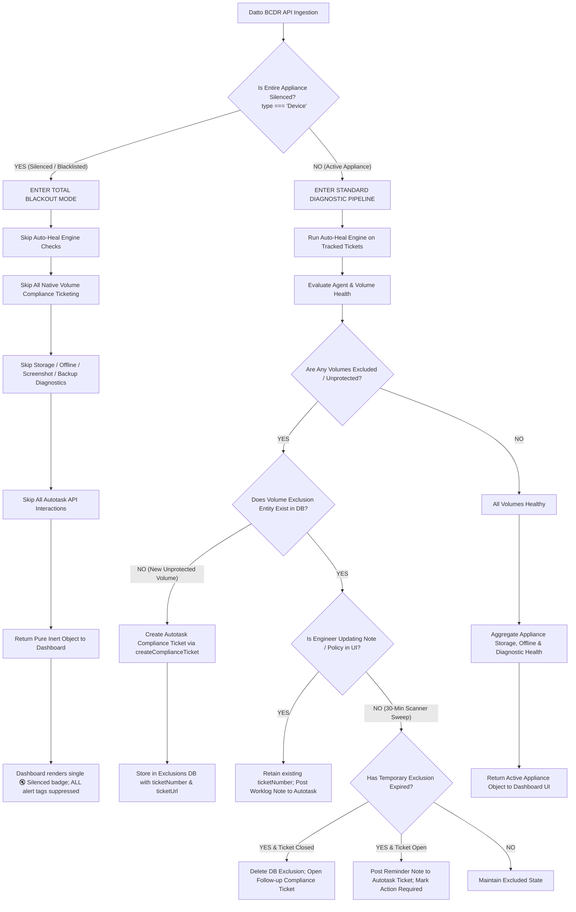

# Datto Appliance & Volume Exclusion Lifecycle Flow

This document details the complete operational lifecycle flow for Datto appliances and volume exclusions in BackupWatch — detailing how Active vs. Silenced appliances are handled across the scanner, API, Autotask ticketing engine, and dashboard UI.

---

## 1. High-Level Lifecycle Architecture

---

## 2. Component-by-Component Rules

### A. Entire Appliance Silence Mode (`type === 'Device'`)
1. **Total Isolation at Pipeline Inception**:
   - Immediate check: `isDeviceSilenced(exclusions, deviceName)`.
   - When an appliance is Silenced:
     - **0** tickets created in Autotask.
     - **0** worklog notes pushed to Autotask.
     - **0** Auto-Heal scans executed against `TrackedTickets`.
     - **0** alert tags rendered in UI (all `Offline`, `Backup Fail`, `Screenshot Fail`, `Storage Warning` tags are strictly suppressed).
2. **Dashboard UI Presentation**:
   - Shows a dedicated **`🔇 Silenced`** status pill.
   - Child agents display **`🔇 Silenced with Appliance`**.
   - Metric cards do not increment alert totals for silenced appliances.

---

### B. Individual Volume Exclusion Flow (`type === 'Volume'`)
1. **Initial Detection (Native Unprotected Volume)**:
   - If parent appliance is NOT silenced, background scanner creates a compliance ticket in Autotask and saves it to Table Storage (`isPermanent: false`, `isUnconfigured: true`, `ticketNumber`, `ticketUrl`).
2. **Note & Policy Update (Dashboard)**:
   - When an engineer edits the note or switches duration (Temporary vs Permanent), the system retains the existing `ticketNumber` and posts a formatted update worklog note to the existing Autotask ticket. **No duplicate tickets are created.**
3. **Expiry Sweep (30-minute Timer Trigger)**:
   - If temporary exclusion expires and Autotask ticket is still open: post reminder note and update ticket status to `Action Required`.
   - If temporary exclusion expires and Autotask ticket was closed without restoring backups: delete exclusion from DB and raise a follow-up ticket.
