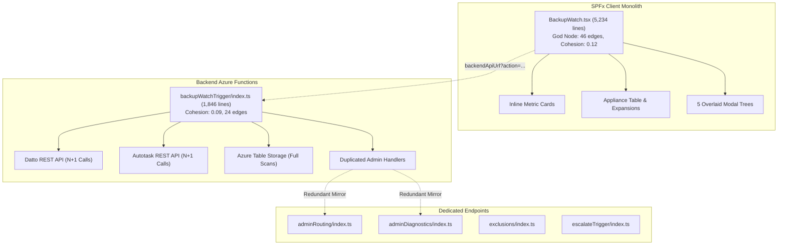
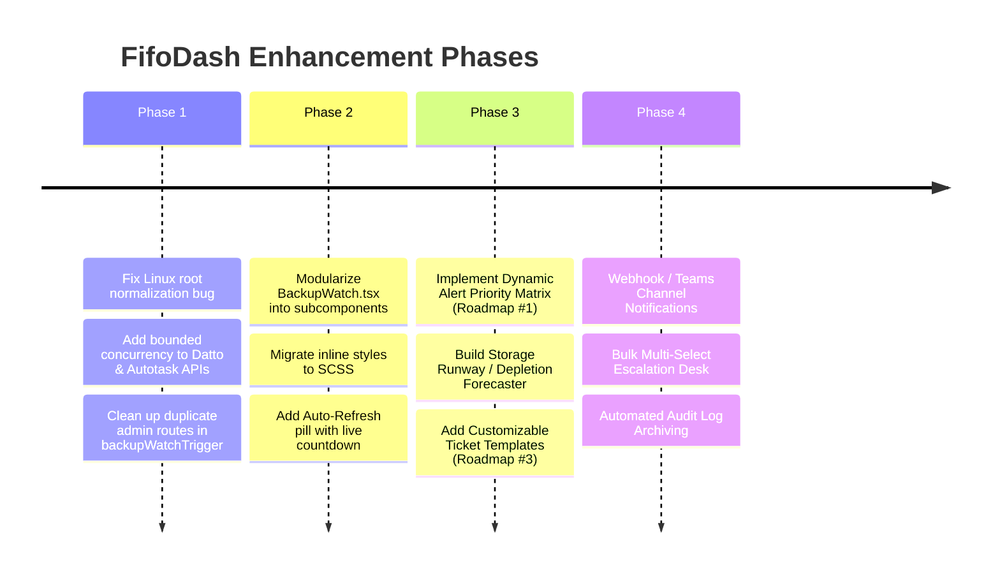

# FifoDash Comprehensive Architectural Scan & Improvement Plan

> **Scope**: SPFx Frontend (`spfx-client`), Stateless Azure Functions (`stateless-backend`), Shared Domain Services, Data Pipelines, and Graphify Topological Analysis.  
> **Repository Context**: Datto BCDR Live Compliance Monitoring, Azure Table Storage, and Autotask REST API Integration.

---

## 1. Executive Summary & Graphify Topological Findings

A topological scan using [REPO_MAP.md](file:///c:/Projects/FifoDash/REPO_MAP.md) and [GRAPH_REPORT.md](file:///c:/Projects/FifoDash/graphify-out/GRAPH_REPORT.md) (365 nodes, 721 edges, 26 communities) identified significant architectural hubs and concentration of responsibilities:



### Key Graph Metrics
1. **God Nodes**:
   - `BackupWatch` in [BackupWatch.tsx](file:///c:/Projects/FifoDash/spfx-client/src/webparts/backupWatch/components/BackupWatch.tsx): 46 edges. A single 5,234-line React class component containing all views, inline styles, DOM event hooks, and modals.
   - `runPipeline()` in [backupWatchTrigger/index.ts](file:///c:/Projects/FifoDash/stateless-backend/backupWatchTrigger/index.ts): 24 edges. Centralizes ingestion, in-memory caching, Datto polling, Autotask syncing, ticket resolution, and alert evaluation.
2. **Low Cohesion Warnings**:
   - `backupWatchTrigger/index.ts` has a cohesion score of **0.09** (heavily overloaded; mixes device data pipelines with admin routing, diagnostics, blackout maintenance, and stale entity purging).
   - `BackupWatch.tsx` has a cohesion score of **0.12** (tightly couples state, data fetching, presentation, and modal workflows).
3. **Redundant Code Clones**:
   - The admin handlers in `backupWatchTrigger/index.ts` (lines 1175–1720) mirror standalone functions [adminRouting/index.ts](file:///c:/Projects/FifoDash/stateless-backend/adminRouting/index.ts) and [adminDiagnostics/index.ts](file:///c:/Projects/FifoDash/stateless-backend/adminDiagnostics/index.ts).
4. **Type Isolation**:
   - 155 nodes (`ITrackedTicketEntity`, `IUserSecurityContext`, `UserRole`, `IAutoTaskConfig`) are weakly connected because interfaces are declared ad-hoc in separate files rather than imported from a single shared contract repository.

---

## 2. Critical Accuracy & Reliability Defects

### 🚨 Discovered Bug: Linux Root Volume Normalization Defect
- **Location**: [volumeUtils.ts:L26-36](file:///c:/Projects/FifoDash/stateless-backend/shared/volumeUtils.ts#L26-L36)
- **Defect**:
  ```typescript
  export function normalizeVolumeName(volumeName: string): string {
      if (!volumeName) return "";
      let clean = volumeName.trim().replace(/\\/g, "/");
      clean = clean.replace(/\/+$/, ""); // <-- BUG: "/" becomes ""
      if (/^[a-zA-Z]:$/.test(clean)) {
          clean = clean.charAt(0);
      }
      return clean.toUpperCase();
  }
  ```
  Executing `normalizeVolumeName("/")` results in `""` (empty string).
- **Impact**: Any Linux guest server with an unprotected or excluded root volume (`/`) has its volume name stripped to empty string, causing `runPipeline()` and `exclusions` checks to skip root volume evaluation entirely.
- **Remediation**:
  ```typescript
  clean = clean.replace(/\/+$/, "");
  if (clean === "" && volumeName.trim() === "/") {
      return "/";
  }
  ```

### ⚡ Autotask & Datto N+1 API Storms
- **Locations**:
  - [backupWatchTrigger/index.ts:L384-392](file:///c:/Projects/FifoDash/stateless-backend/backupWatchTrigger/index.ts#L384-L392)
  - [backupWatchTrigger/index.ts:L454-471](file:///c:/Projects/FifoDash/stateless-backend/backupWatchTrigger/index.ts#L454-L471)
- **Defect**:
  1. `ticketResults = await Promise.all(ticketIds.map(async (id) => getSingleTicketFromAutoTask(id, autotaskConfig)))`: 50 active tracked tickets generate 50 simultaneous HTTP GET requests against Autotask REST API.
  2. `devices = await Promise.all(rawDevices.map(async (device) => axios.get(.../asset)))`: 80 appliances generate 80 concurrent HTTP requests against Datto BCDR API.
- **Impact**: Risks HTTP 429 (Rate Limit / Too Many Requests) and zone throttling, leading to dropped telemetry or pipeline fallbacks.
- **Remediation**:
  - Implement query-based batching for Autotask (e.g. `Contracts/query` or chunked ticket queries in groups of 10).
  - Use a bounded concurrency helper (such as `p-limit` or chunked parallel batches with max concurrency of 5-8) with exponential backoff retry.

### 🔄 Ticket Lifecycle State Machine
- **Location**: [backupWatchTrigger/index.ts:L414-436](file:///c:/Projects/FifoDash/stateless-backend/backupWatchTrigger/index.ts#L414-L436)
- **Issue**: Only Autotask status `5` (Completed) causes deletion of the tracking row in Azure Table Storage.
- **Impact**: If a ticket is marked "Cancelled", "Waiting Customer", or merged into another ticket, it remains indefinitely marked as "Active" or orphaned in `TrackedTickets`.
- **Remediation**: Expand deletion criteria to include status IDs mapped to "Cancelled", "Closed - No Action", or add a configurable terminal status picklist check.

---

## 3. UI & Frontend Architecture Improvements (`spfx-client`)

### 1. Component Modularization (Breaking Down the 5,234-Line Monolith)
Extract distinct subcomponents out of [BackupWatch.tsx](file:///c:/Projects/FifoDash/spfx-client/src/webparts/backupWatch/components/BackupWatch.tsx):
- `MetricCardGrid.tsx`: Metric cards, filter states, and zero-count styling.
- `ApplianceTable.tsx`: Main table rendering, search filtering, and pagination.
- `ApplianceRow.tsx` & `AgentRow.tsx`: Expandable hierarchy for agents, volume disks, and screenshot popovers.
- `MutingModal.tsx`: Silence appliance/agent/volume modal with dynamic duration and ticket validation.
- `EscalateModal.tsx`: Multi-issue escalation dialog.
- `AdminConsoleModal.tsx`: Tabbed administrator dialog (Diagnostics, Routing, Maintenance Blackout, Cleanup, Asset Tester).

### 2. Rendering Performance & DOM Optimization
- **Problem**: Changing search text or toggling an appliance expands/collapses re-renders the entire 5,000+ line JSX tree. Direct style manipulation via `onMouseEnter`/`onMouseLeave` (lines 1724–1739) causes unmanaged layout reflows.
- **Optimization**:
  - Replace inline hover mutations with dedicated CSS classes in `BackupWatch.module.scss`.
  - Memoize filtered devices using `React.useMemo` or pure functional subcomponents with `React.memo`.
  - Introduce table row virtualization (e.g. `react-window` or virtual scrolling) for environments with 100+ appliances and 500+ agents.

### 3. Usability & UX Enhancements
- **Auto-Refresh with Live Countdown Pill**:
  - Provide a selectable timer (e.g. `Auto-Refresh: Off | 2m | 5m | 10m`) in the control desk header with a subtle circular/pill progress indicator.
- **Expiring Silence Warnings**:
  - Display an amber pill badge (`Expiring Soon (<24h)`) next to temporary exclusions close to their deadline.
- **Sticky Table Headers & Multi-Column Sorting**:
  - Allow sorting appliances by Storage Used (%), Backup Failure Count, Last Check-in, or Client Company Name.
- **Bulk Action Checkboxes**:
  - Multi-select appliances or agents to trigger batch silences or bulk ticket generation in a single workflow.

---

## 4. Backend Workflows & Performance Improvements (`stateless-backend`)

### 1. Consolidate Dual Routing Implementations
- **Issue**: Admin requests currently hit `backupWatchTrigger?action=adminRouting`, requiring duplicate code in both [backupWatchTrigger/index.ts](file:///c:/Projects/FifoDash/stateless-backend/backupWatchTrigger/index.ts) and [adminRouting/index.ts](file:///c:/Projects/FifoDash/stateless-backend/adminRouting/index.ts).
- **Remediation**:
  - Standardize frontend SPFx calls to point to the dedicated micro-functions (`/api/adminRouting`, `/api/adminDiagnostics`, `/api/auditLogs`).
  - Strip the duplicate 700+ lines of admin logic from `backupWatchTrigger/index.ts`, restoring its focus solely to telemetry collection and SLA evaluation.

### 2. Azure Table Storage Query Optimization
- **Issue**: [adminDiagnostics/index.ts:L48-60](file:///c:/Projects/FifoDash/stateless-backend/adminDiagnostics/index.ts#L48-L60) iterates through all entities in `Exclusions`, `TrackedTickets`, and `AuditLogs` just to calculate row counts.
- **Optimization**:
  - Use select projections (`select: ["PartitionKey", "RowKey"]`) to minimize Azure network payload.
  - Implement a dedicated metadata counter row in `SystemConfig` updated atomically during insert/delete, avoiding $O(N)$ full-table enumerations on every diagnostic click.

### 3. Unified Shared Contracts (`stateless-backend/shared/types.ts`)
- Consolidate all domain interfaces (`IDattoDevice`, `IAgentResult`, `ITrackedTicketEntity`, `IExclusionEntity`, `IAutotaskRoutingConfig`) into a single source of truth shared between backend functions and exported to the SPFx client.

---

## 5. Candidate New Features & Roadmap Enhancements

| Feature | Category | Description | Business Value |
| :--- | :--- | :--- | :--- |
| **1. Dynamic Alert Priority Matrix** | Workflow | Implement severity-to-priority routing (Critical = P1/P2 for >90% storage or >48h offline; Medium = P3 for >24h backup failure; Low = P4 for volume exclusions). | Directly addresses **Roadmap Item #1**; prevents SLA breach on critical outages. |
| **2. Storage Runway & Exhaustion Predictor** | Telemetry / AI | Calculate daily storage ingestion delta (GB/day) over 7–14 days and display "Estimated Days to Full" (e.g. `⚠️ 18 days runway`). | Proactive capacity planning; avoids sudden appliance lockouts. |
| **3. Customizable Ticket Title & Body Templates** | Automation | Allow administrators to define templated formats with dynamic tokens (`{CompanyName}`, `{DeviceName}`, `{AgentName}`, `{FailureReason}`). | Addresses **Roadmap Item #3**; aligns with service desk parsing rules. |
| **4. Webhook / Teams Alert Dispatcher** | Integration | Dispatch adaptive cards or webhook notifications to Microsoft Teams when P1 critical outages occur or global maintenance windows are activated. | Instant NOC visibility without requiring an active browser tab. |
| **5. Batch Issue Escalation** | UI / Efficiency | Enable engineers to select multiple failed backups across appliances and dispatch tickets in a single batch operation. | Saves service desk dispatch time during mass ISP or network outages. |
| **6. Audit Log Retention & Archiving Policy** | Compliance | Add automated Table Storage retention policies or export to Blob Storage for logs older than 90 days. | Keeps table queries sub-50ms and satisfies compliance standards. |

---

## 6. Recommended Phased Implementation Roadmap


