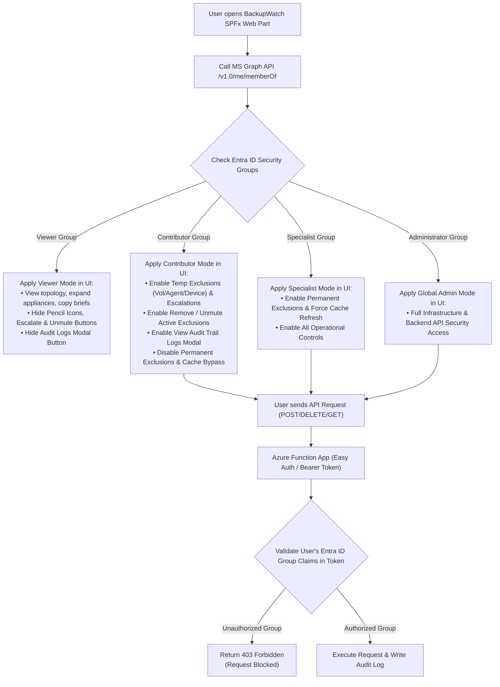

# 🔐 Entra ID Security Group Role-Based Access Control (RBAC) Architecture
### Comprehensive Security & Permissions Proposal for BackupWatch

This proposal outlines a granular, enterprise-grade Role-Based Access Control (RBAC) system for BackupWatch using Microsoft Entra ID Security Groups. Permissions are strictly enforced both in the **SharePoint SPFx React UI** (hiding/disabling unauthorized controls) and at the **Azure Function API** level (rejecting unauthorized API calls with `403 Forbidden`).

---

## 1. Proposed Security Group Roles

We define 4 distinct tiers of access based on Entra ID Security Groups:

1. **`BackupWatch-Viewer`** *(All Staff / Auditors / Management / Readonly)*
   - Read-only visibility into operational metrics, appliance lists, agent details, exclusions lists, ticket briefs, and screenshots.
2. **`BackupWatch-Contributor`** *(Service Desk Tier 1 & Tier 2 / Operations)*
   - Day-to-day operations: creating temporary exclusions (volume, agent, appliance), editing notes, un-muting/removing active exclusions & silences, viewing audit trail logs, and manually escalating Autotask tickets.
3. **`BackupWatch-Specialist`** *(Backup Lead Engineers / Infrastructure Engineers / Admins)*
   - Full operational & management control: permanent exclusions (no expiry), cache bypass sweeps, and audit trail inspection.
4. **`BackupWatch-Administrator`** *(System Administrators / Security Lead / SuperAdmins)*
   - Global administrative authority: backend app settings, API security management, and Entra ID security group role assignments.

---

## 2. Granular Permissions & Control Matrix

| Feature / Action in BackupWatch | Viewer | Contributor | Specialist | Administrator |
| :--- | :---: | :---: | :---: | :---: |
| **View Dashboard & Appliance List (Active / Cancelled)** | ✅ | ✅ | ✅ | ✅ |
| **Search, Metric Tile Filtering & Appliance Expand** | ✅ | ✅ | ✅ | ✅ |
| **View Active Exclusions List (Settings Table)** | ✅ | ✅ | ✅ | ✅ |
| **Copy Ticket Brief & View Screenshots** | ✅ | ✅ | ✅ | ✅ |
| **Escalate Ticket to Autotask (Manual Bulk/Inline)** | ❌ | ✅ | ✅ | ✅ |
| **Create Temporary Volume Exclusion (1–30 Days)** | ❌ | ✅ | ✅ | ✅ |
| **Create Temporary Agent Silencing (1–30 Days)** | ❌ | ✅ | ✅ | ✅ |
| **Create Temporary Appliance Silencing (1–30 Days)** | ❌ | ✅ | ✅ | ✅ |
| **Edit Existing Temporary Exclusion Note / Duration** | ❌ | ✅ | ✅ | ✅ |
| **Create Permanent Volume Exclusion (No Expiry)** | ❌ | ❌ | ✅ | ✅ |
| **Create Permanent Agent Silencing (No Expiry)** | ❌ | ❌ | ✅ | ✅ |
| **Create Permanent Appliance Silencing (No Expiry)** | ❌ | ❌ | ✅ | ✅ |
| **Remove / Unmute Active Exclusions & Silencing** | ❌ | **✅** | ✅ | ✅ |
| **View Audit Trail Logs Modal (`/api/auditlogs`)** | ❌ | **✅** | ✅ | ✅ |
| **Force Cache Refresh (`/api/backupWatchTrigger?force=true`)** | ❌ | ❌ | ✅ | ✅ |
| **Backend App Settings & API Security Management** | ❌ | ❌ | ❌ | ✅ |

---

## 3. Architecture & Security Enforcement Layer

---

## 4. Technical Implementation Details

### A. SPFx React UI Enforcement
- **Graph Group Resolution**: On initial web part load, query `MSGraphClientV3` endpoint `/v1.0/me/memberOf` to retrieve the current user's group Object IDs.
- **Conditional Component Rendering**:
  - `userRole === 'Viewer'`: Hide pencil edit icons on agent cards, hide "Configure Exclusions" settings button, hide "Audit Trail Logs" button, and disable ticket escalation and remove/unmute buttons.
  - `userRole === 'Contributor'`: Enable temporary exclusions (Volume, Agent, Appliance), ticket escalations, note edits, **View Audit Trail Logs modal**, and **Remove / Unmute** buttons across all tiers. Disable only the `Permanent Exclusion` radio option in the Mute Modal and the Force Cache Refresh button.
  - `userRole === 'Specialist'`: Enable all modal options, permanent exclusions, force cache refresh, audit trail inspection, and operational management.
  - `userRole === 'Administrator'`: Full administrative authority including backend configuration and security management.

### B. Azure Function Backend Enforcement (`/stateless-backend`)
- **Group Claim Inspection**: Decode the `X-MS-CLIENT-PRINCIPAL` header or Bearer JWT token to extract the user's `groups` array.
- **App Settings Configuration**: Store target Group Object IDs in Function App Settings:
  - `RBAC_CONTRIBUTOR_GROUP_ID`
  - `RBAC_SPECIALIST_GROUP_ID`
  - `RBAC_ADMIN_GROUP_ID`
- **Endpoint Guard Middleware**:
  - `POST /api/exclusions`: Reject with `403 Forbidden` if user is not in `Contributor`, `Specialist`, or `Administrator` group. Reject `isPermanent: true` if user is only in `Contributor` group.
  - `DELETE /api/exclusions`: Authorized for `Contributor`, `Specialist`, and `Administrator` groups (allows operational un-muting with mandatory audit trail logging).
  - `GET /api/auditlogs`: Authorized for `Contributor`, `Specialist`, and `Administrator` groups (allows viewing audit history while blocking Viewer users).
  - `POST /api/escalate`: Authorized for `Contributor`, `Specialist`, and `Administrator` groups.
  - `GET /api/backupWatchTrigger?force=true`: Restricted to `Specialist` and `Administrator` groups.

---

## 5. Next Steps for Feedback

Please review this proposal document. You can customize:
1. **The Role Names** (e.g., matching your existing Entra ID group naming conventions).
2. **The Matrix Actions** (adding or shifting specific actions between roles).
