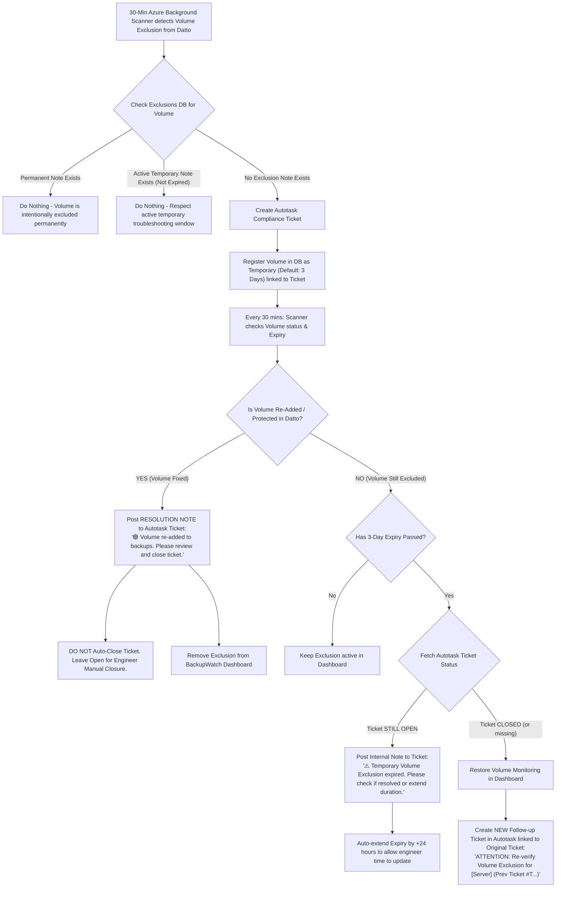

# 🛡️ Temporary vs. Permanent Volume Exclusion Lifecycle
### Joint Proposal from the BackupWatch Engineering Team (Updated with Service Desk Requirements)

## 1. Core Workflow Architecture

---

## 2. Updated Rules & Behavior Matrix

| Scenario | Background Scan Action | Autotask Action | Expiry / Next Steps |
| :--- | :--- | :--- | :--- |
| **New volume exclusion detected in Datto** (No note exists) | Registers volume as **Temporary (3 Days)** | Creates Compliance Ticket | Engineer receives ticket and begins troubleshooting. |
| **Engineer saves `Temporary` Note / Exclusion** | Sets temporary duration (1, 3, 7, 14, 30 Days) | Posts worklog note to ticket | **Reason is OPTIONAL**; Autotask Ticket # is mandatory. |
| **Engineer saves `Permanent` Note / Exclusion** | Excludes volume indefinitely | Posts worklog note to ticket | **Reason is STRICTLY MANDATORY**; Autotask Ticket # is mandatory (Specialist/Admin only). |
| **Volume re-added/protected in Datto** | Clears exclusion from dashboard | **Posts Resolution Note** on ticket *(Ticket stays open)* | Engineer reviews note and closes ticket manually in Autotask. |
| **Temporary 3 Days pass & Ticket is STILL OPEN** | Extends expiry by +24 hours | **Posts Worklog Reminder Note** on ticket | Engineer is alerted to extend expiry or complete fix. |
| **Temporary 3 Days pass & Ticket was CLOSED without resolving** | Restores volume monitoring in dashboard | **Opens NEW Follow-up Ticket** referencing old ticket | Engineers alerted that an excluded volume was left unmonitored. |

---

## 3. Team Technical Implementation Plan

### 🎨 Frontend Integration Agent (SPFx UI / Modal)
1. **Exclusion Modal Upgrade**:
   - Add **Exclusion Type Toggle**:
     - `[x] Permanent Exclusion` (No expiry, note persists).
     - `[ ] Temporary Exclusion (Default)` (Selectable duration dropdown: **3 Days (Default)**, **7 Days**, **14 Days**, **Custom**).
   - Add optional **Autotask Ticket Number Input Field** (e.g. `T20260812.0042`) so engineers can manually link an exclusion to an existing ticket.
2. **Visual Indicators on Agent Cards**:
   - Display a clock badge `🕒 Temp (2 days left)` or `♾️ Permanent` next to excluded volumes on the agent cards and Settings modal.

---

### ⚙️ Backend Serverless Agent (Azure Function Engine)
1. **Database Schema Update (`Exclusions` Table Storage)**:
   - Entity fields:
     - `isPermanent`: `boolean`
     - `expiresAt`: `ISO Timestamp` (or null if permanent)
     - `ticketNumber`: `string` (Linked Autotask ticket number)
     - `ticketId`: `string` (Internal Autotask ticket ID)
2. **Timer Trigger Logic (`backupWatchTimerTrigger`)**:
   - **Re-Protected Volume Check**: If volume is protected in Datto, post resolution note to Autotask ticket (do NOT close ticket), delete exclusion entity.
   - **Expired Exclusion Sweep**:
     - If ticket is OPEN: Post internal reminder note, extend `expiresAt` by +24 hours.
     - If ticket is CLOSED: Delete exclusion entity, create new follow-up review ticket referencing original ticket ID/Number.

---

### 🚀 Project Orchestrator Agent (Deployment Strategy)
- **Backward Compatibility**: Existing exclusions without `isPermanent` set will default to `isPermanent = true`.
- **Package Release**: Requires MINOR version bump to **v1.12.0**.
