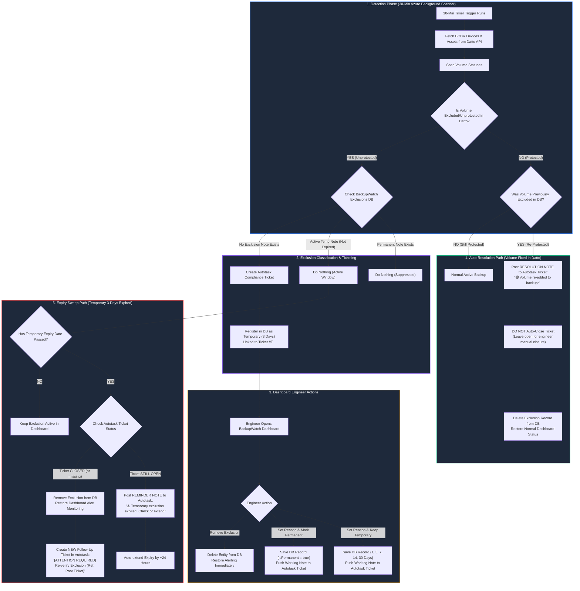
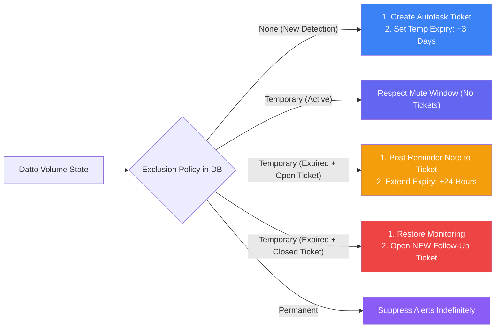

# 📊 BackupWatch Volume Exclusion Logic & Workflow Diagram

This document contains a comprehensive visual flowchart illustrating the complete end-to-end lifecycle of **Datto BCDR Volume Exclusions** in BackupWatch — covering automatic background detection, manual dashboard mutes, temporary vs. permanent policy routing, and Autotask ticket integration.

---

## 1. High-Level System Workflow Diagram

---

## 2. Detailed Decision Logic & Rules Table

---

## 3. Key Operational Rules Summary

1. **Auto-Detection**: The 30-minute Azure background scanner automatically picks up any volume marked `unprotected` in Datto.
2. **Default Policy**: Automatically assigns a **Temporary 3-Day Exclusion** linked to the auto-created Autotask compliance ticket.
3. **No Ticket Auto-Closing**: When an engineer fixes the volume in Datto, BackupWatch posts a **Resolution Note** to the ticket asking the engineer to close it manually. Tickets are **NEVER auto-closed** by the system.
4. **Note Push**: Whenever an engineer updates a reason note in the BackupWatch Dashboard, an internal worklog note is instantly pushed to the Autotask ticket with the updated reason and expiry date.
5. **Closed Ticket Escalation**: If a temporary exclusion expires and the ticket was closed prematurely without fixing the volume, BackupWatch **restores active dashboard monitoring** and opens a **NEW follow-up ticket** referencing the previous ticket number.
